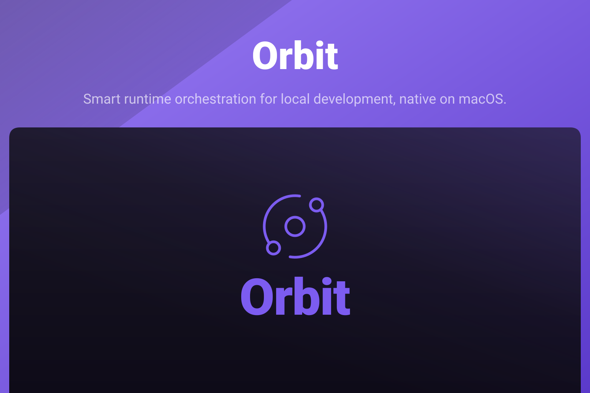

<p align="center">
  
</p>

<p align="center">
  <a href="https://github.com/akira-foundation/orbit/actions/workflows/test.yml"></a>
  
  
  
</p>

Orbit runs the projects on your Mac and serves each one at `https://<project>.orbit.test`. It detects the
framework and the dev command, starts the runtime when a request arrives, suspends it when idle, and provides
Postgres, Redis, MinIO and Mailpit for the projects that need them. The interface is SwiftUI, and the sites
keep answering with the window closed.

Orbit is being rewritten in Swift. This repository holds the package skeleton; the features land plan by plan.

## Documentation

- [Index](docs/00-index.md)
- [Architecture](docs/01-architecture.md)

## Testing

```sh
make test          # Core suite, without building the app
make build         # every target, app included
make lint          # house rules
make swiftlint     # SwiftLint, strict
make format-check  # swift-format, strict
```

## Changelog

The changelog is generated from conventional commits via [git-cliff](https://git-cliff.org) and
will be published as `CHANGELOG.md` with the first tagged release.

## Contributing

Please see [CONTRIBUTING.md](CONTRIBUTING.md) for details.

## Security Vulnerabilities

Please review [our security policy](SECURITY.md) on how to report security vulnerabilities.

## Credits

- [Akira Foundation](https://github.com/akira-foundation)
- [All Contributors](https://github.com/akira-foundation/orbit/graphs/contributors)

## License

Dual-licensed under either of the following, at your option:

- MIT License ([LICENSE-MIT](LICENSE-MIT) or https://opensource.org/licenses/MIT)
- Apache License 2.0 ([LICENSE-APACHE](LICENSE-APACHE) or https://www.apache.org/licenses/LICENSE-2.0)

Unless you explicitly state otherwise, any contribution intentionally submitted for inclusion in
this project by you, as defined in the Apache-2.0 license, shall be dual-licensed as above, without
any additional terms or conditions.
